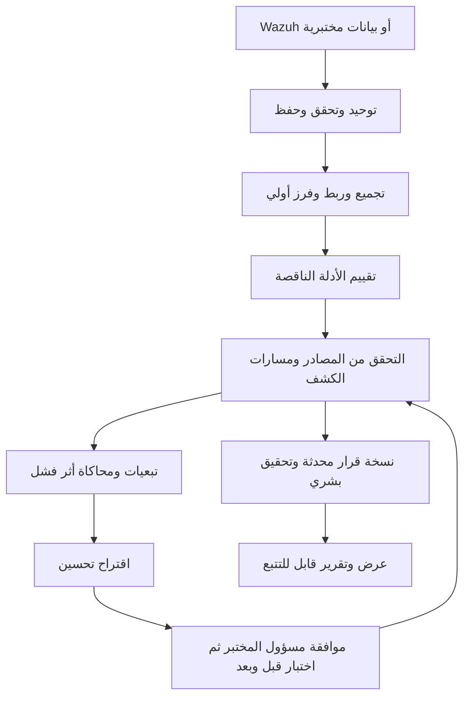

# تسلسل النظام الموحد

هذا هو المرجع للسلوك المتسلسل؛ يحافظ على الاختصار الأولي ثم الفحص والتغذية الراجعة. أسماء المراحل تصميم أولي وليست حالات قاعدة بيانات معتمدة بعد.

## رحلة الحالة

| المرحلة | المدخل | المخرج | عند الفشل أو النقص |
|---|---|---|---|
| 1. Ingest | JSON من موصل أو عينة اصطناعية | هوية مصدر وتوقيت ومصدر حقول | رفض موثق أو عزل الإدخال غير الصالح، دون قبوله كدليل صحيح |
| 2. Preliminary triage | أحداث موحدة | مجموعة حادث وأولوية أولية وأسباب | لا حذف للأصول، ولا حكم benign من التشابه |
| 3. Evidence review | نوع التحقيق والأدلة | قائمة متطلبات الأدلة وحالة كل منها | missing أو unavailable أو unknown مع السبب |
| 4. Coverage check | الجهاز والسيناريو والفترة | دليل اختبار وصحة مصدر وتغطية محددة | نقص حقل ليس برهان عطل؛ تحقق من التأخير والصلاحيات والإعدادات |
| 5. Reassess | الفرز والأدلة وحالة التغطية | نسخة قرار جديدة وسبب الاختلاف | لا تخفيض تلقائي استناداً لغياب تنبيه خلال فجوة تغطية |
| 6. Resilience analysis | خريطة تبعيات مختبرة | توقع أثر فشل ومجموعات حرجة | إن كانت الخريطة ناقصة فالنتيجة bounded/unknown، لا صمود شامل |
| 7. Improve and verify | تحسين مرشح وحالة اختبار | مقارنة قبل/بعد وأثر وكلفة وحدود | الاقتراح غير المختبر ليس إصلاحاً مثبتاً |

صحة المصادر وخريطة الاختبارات تبنى وتحدث أيضاً خارج وجود حادث، لتكون متاحة في المرحلة 4؛ لا ننتظر حذف التنبيهات أو انتهاء التحقيق حتى نجمع معلومات المراقبة. يعرض النظام الأولوية الأولية سريعاً بعلامة provisional إذا تعذر الفحص، ثم يحدثها عند وصول الأدلة.

## مثال واحد مترابط

محاولات فاشلة ثم نجاح مرتبط: تجمع بحادث. غياب نشاط لاحق يفتح سؤالاً عن الأدلة. إذا كان جمع أحداث تشغيل العمليات متوقفاً، نذكر أن نشاط العمليات غير قابل للتقييم، لا أن الدخول آمن. نرسم مسارات رصد تشغيل عملية اختبارية؛ نجرب تعطيل قناة واحدة ثم المكوّن المشترك. يقاس أثر تحسين مصرح به على هذا السيناريو فقط. لا تدعي تجربة تشغيل عملية أنها تتحقق من كل جوانب اختراق الحساب.

## حدود القرار

- priority: low/medium/high لترتيب العمل، مع أسباب.
- judgment: benign/malicious/unknown لحكم التحقيق؛ لا يستنتج من priority.
- coverage: verified/degraded/failed/unknown/not_applicable لسيناريو وجهاز وفترة وإعدادات محددة.
- failure_prediction: محاكاة على النموذج، مميزة دائماً عن test_result: نتيجة اختبار واقعي.

فقد التغطية لا يضيف وحده دليلاً ضاراً أو يرفع درجة الهجوم حسابياً؛ يفرض عدم اليقين ومهمة تحقق وقد يغير أولوية جمع الأدلة وفق سياسة موثقة. لا نغلق كل التنبيهات منخفضة الأولوية قبل المرحلة 4؛ نسجل سبب عدم الفحص إن استعملنا عينات أو معالجة مجمعة.

كل تحديث يحفظ decision_version ووقت القرار ومعرفات الأدلة وإصدارات القواعد والخريطة والاختبار. اختبار مصدر اليوم لا يثبت أنه كان سليماً أمس. الأدلة المتأخرة تعيد التقييم بإصدار جديد دون تسريب المستقبل إلى تجربة تاريخية.

## التنفيذ الأول

التسلسل متزامن وبسيط داخل تطبيق واحد على بيانات صغيرة؛ لا نحتاج خدمات موزعة أو طوابير مبكراً. التجارب الطويلة على المختبر ليست جزءاً من طلب HTTP العادي ولا ينفذها API تلقائياً؛ يسجل backend نتائجها ويستدعي التحليل الحسابي. عند الحاجة لاحقاً توثق جدولة المهام والمهلات وإعادة المحاولة.

